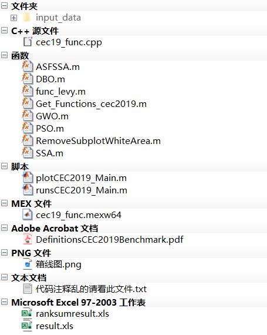
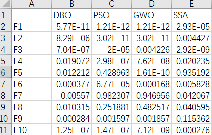
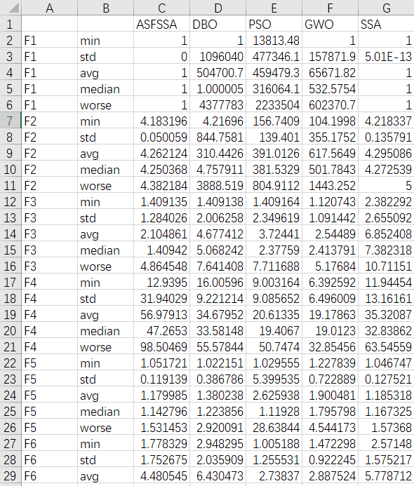
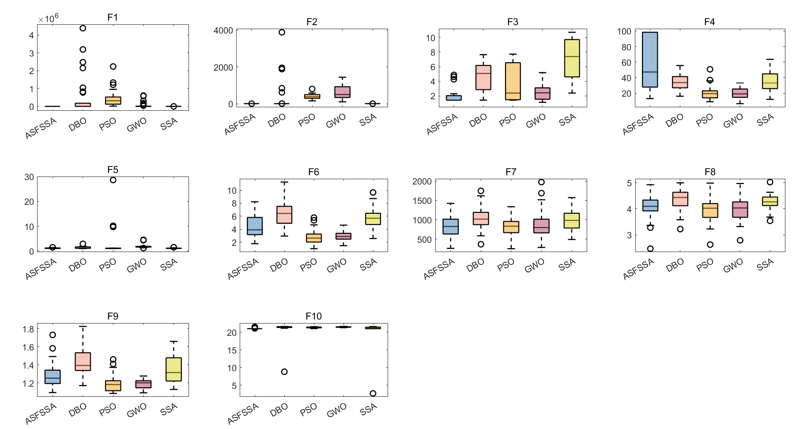

# CEC2019 Function Set Optimal Value, Average, Standard Deviation, Worst Value, Median, Rank Sum Test, Boxplot, Common Indicators of Intelligent Optimization Algorithms Exported to Excel

Previously, we published an article on the intelligent algorithm metrics for the CEC2005 function set. However, many backers have inquired about how to call other function sets. Today, we will use the CEC2019 function set as an example to demonstrate this.

To highlight the effectiveness of improving intelligent optimization algorithms, it is common to compare them with other algorithms.

In some journal papers, a very large table is often seen that summarizes the average values, standard deviations, optimal values, worst values, and medians of each algorithm. For example:

Some papers also conduct rank sum tests to compare the differences between improved algorithms and their counterparts. For instance:

Other papers may present box plots to make the comparison more intuitive. For example:

However, if you had to manually run code over and over again to perform these calculations, even superheroes would probably not do it!

Today, we will use MATLAB tools to teach everyone how to directly complete the statistics and export an Excel table, while also drawing a box plot.

The algorithm replacement process is very simple; just replace the algorithm name! The test set replacement is also straightforward!

This issue will take the Adaptive Spiraling Flight Sparrow Search Algorithm (ASFSSA) (click the link to access, which can be freely obtained) as an example, and compare it with the Beetle Optimization Algorithm, Sparrow Optimization Algorithm, Particle Swarm Optimization Algorithm, and Grey Wolf Optimization Algorithm.

Each algorithm will be run 30 times in the CEC2019 function, tested in the CEC2019 function, and five indicators such as the optimal value, average value, standard deviation, median, and worst value will be automatically calculated. Additionally, a rank sum test result will be drawn, and a box plot will be generated simultaneously.

The code directory is as follows:
\n        \n  
The script "plotCEC2019_Main.m" remains the same as usual, which is a program for comparing algorithms. 
The key point is that when you run the script "runsCEC2019_Main.m", it will generate two Excel files: ranksumresult.xls and result.xls. The former contains the results of the rank sum test, while the latter contains statistics for five indicators. The results are as follows:
Ranksumresult.xls table:
\n        \n  
result.xls table:
\n        \n  
The code in the program has been set to allow for the selection of whether or not box plots should be drawn, and it can also be changed with a single click. The box plot is as follows:
\n        \n  
Partial code display  
The code for runsCEC2019_Main.m is as follows:
clear\nclc\nclose all\naddpath(genpath(pwd));\npop_size=30;   %Population number\nmax_iter=500;   % Iteration count\nrun = 30;\nbox_pp = 1;  % Optional: 1, or other. When equal to 1, draw a box plot; otherwise, do not draw.\nRESULT=[];   % Calculate the results such as standard deviation, mean, optimal value, etc.\nrank_sum_RESULT=[];  % Calculate the rank sum test results\nF = [1 2 3 4 5 6 7 8 9 10];\ndisp(['The one being counted is...CEC2019Function set'])\nif box_pp ==1\n    figure('Name', 'Box plot', 'Color', 'w','Position', [50 50 1400 700])\nend\nfor func_num = 1:length(F)   \n    % Display the comprehensive results\n    disp(['F',num2str(F(func_num)),'Function calculation results: '])\n    num=F(func_num);\n    [lower_bound,upper_bound,variables_no,fobj]=Get_Functions_cec2019(num);  % [lb,ub,D,y]: lower bound, upper bound, dimension, objective function expression\n    resu = [];  % Calculate the standard deviation, mean, optimal value, etc.\n    rank_sum_resu = [];   % Calculate the rank sum test results\n    box_plot = [];  % Statistical box plot results\n    ……\nend\n%% Write the rank sum test result into elcex\nB = string();\nfor i = 1:length(F)\n    str = string(['F',num2str(F(i))]);\n    B(i,1)= str;\nend\nB = cellstr (B);\nB = [B,num2cell(rank_sum_RESULT)];\ntitle = {" ","DBO","PSO","GWO","SSA"};% The rank sum test is compared with an improved algorithm, hence there is no improved algorithm here.\nB = [title;B];\nxlswrite('ranksumresult.xls', B)\n​\n%% Write the results of standard deviation, mean, optimal value, etc. into elcex.\nA = string();\nA = cellstr (A);\nA = [A,num2cell(RESULT)];\ntitle = {" "," ","ASFSSA","DBO","PSO","GWO","SSA"};\nA = [title;A];\nxlswrite('result.xls', A)\n\n  

## Images

<!-- PAYMENT_BLOCK -->

## Get this dataset

- Payment link (Stripe): [Buy now](https://buy.stripe.com/3cs8yP7sY87d0vu9AB)
- Payment QR code: 

<!-- /PAYMENT_BLOCK -->
